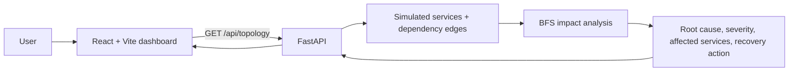

# CascadeGuard AI — Software Failure Intelligence

CascadeGuard AI is a small, explainable hackathon prototype that demonstrates how one failed microservice can affect services that depend on it. A React dashboard requests a simulated topology from a FastAPI backend. The backend uses breadth-first search (BFS) over a dependency graph to identify transitive dependents, label them at-risk, summarize severity, and recommend a recovery action.

> **Prototype limits:** The service topology, failure, and event log are simulated. This project does not monitor real infrastructure, ingest production telemetry, or use a trained AI/ML model. The analysis is deterministic rule-based graph traversal. It runs locally and uses no paid APIs.

## Features

- Dark dashboard with service health summary cards
- Eight simulated services and a dependency graph
- Backend-driven root-cause summary, severity, affected-service list, and recovery recommendation
- **Run Analysis** requests fresh analysis from FastAPI
- Loading, connection-error, and retry states
- Health endpoint and interactive API documentation
- Dependency-free Python unit tests for the analysis engine
- Responsive layout for narrower screens

## Tech stack

- Frontend: React 18, Vite 5, plain CSS
- Backend: Python, FastAPI, Uvicorn
- Analysis: Python `collections.deque` BFS over a directed dependency graph
- Data: local simulated Python data; no external API or database required

## Project structure

```text
cascadeguard_ai/
├── backend/
│   ├── app/
│   │   ├── __init__.py
│   │   ├── analysis.py       # BFS impact analysis and recommendations
│   │   ├── data.py           # Simulated services and dependency edges
│   │   └── main.py           # FastAPI routes
│   ├── tests/
│   │   └── test_analysis.py
│   └── requirements.txt
├── frontend/
│   ├── src/
│   │   ├── components/       # Dashboard sections
│   │   ├── api.js             # Frontend-to-backend requests
│   │   ├── App.jsx
│   │   ├── data.js            # Clearly labelled sample event log
│   │   └── style.css
│   ├── package.json
│   └── vite.config.js
├── SUBMISSION_CHECKLIST.md
└── README.md
```

## Architecture



An edge `A -> B` means **service A depends on service B**. The analyzer reverses those edges for traversal, so a failed dependency can be traced to its direct and transitive dependents. The seeded failure is Payment Service. In this topology, Order Service and Notification Service are directly affected, and API Gateway is marked at-risk because it depends on Order Service.

## Requirements

Install these locally:

- Python 3.10 or newer
- Node.js 18 or newer (Node.js 20 LTS is recommended)
- npm, included with Node.js
- VS Code (optional but convenient)

No cloud account, secret key, or paid service is required.

## Run on Windows (VS Code)

### 1. Start the backend

Open a terminal in the project root:

```powershell
cd backend
py -m venv .venv
.venv\Scripts\Activate.ps1
python -m pip install -r requirements.txt
python -m uvicorn app.main:app --reload
```

If PowerShell blocks activation, either use `Set-ExecutionPolicy -Scope Process -ExecutionPolicy Bypass` in that terminal and activate again, or run the environment's Python directly with `.venv\Scripts\python.exe -m pip install -r requirements.txt` and `.venv\Scripts\python.exe -m uvicorn app.main:app --reload`.

The API should be available at:

- Health: <http://127.0.0.1:8000/health>
- Topology and analysis: <http://127.0.0.1:8000/api/topology>
- Interactive API docs: <http://127.0.0.1:8000/docs>

Leave this terminal running.

### 2. Start the frontend

Open a **second** terminal at the project root:

```powershell
cd frontend
npm install
npm run dev
```

Open <http://localhost:5173>. The dashboard requests analysis from the backend on load. Click **Run Analysis** to send the request again. If the backend is stopped, the UI should display a connection error and a Retry button.

### Optional API base URL

For a different backend address, create `frontend/.env` with:

```env
VITE_API_BASE_URL=http://127.0.0.1:8000
```

Restart the Vite development server after changing environment variables. Do not put secrets in Vite environment variables; values prefixed with `VITE_` are exposed to the browser.

## Tests and build checks

### Backend unit tests

From the project root:

```powershell
cd backend
python -m unittest discover -s tests -v
```

The tests cover the seeded failure's impact, the analysis response, and ensuring repeated calls do not mutate shared demo data.

### Frontend production build

From the project root, in a terminal with Node.js installed:

```powershell
cd frontend
npm install
npm run build
```

Vite writes the production output to `frontend/dist/`. `node_modules/` and `dist/` are intentionally excluded from source control; reinstall dependencies with `npm install` on your own machine.

### Manual integration check

1. Start FastAPI and confirm `/health` returns `{"status":"ok"}`.
2. Open `/api/topology` and check that the response contains `services`, `edges`, and `analysis`.
3. Start Vite and open the dashboard.
4. Confirm the cards and graph show the failed Payment Service and at-risk dependents.
5. Click **Run Analysis** and confirm the loading state ends and the results remain populated.
6. Stop FastAPI and click **Run Analysis** to confirm the connection error and Retry button appear. Restart FastAPI and retry.

## Git commit suggestions

If you are tracking the four project milestones, the intended messages are:

1. `Initialize CascadeGuard AI project and backend engine`
2. `Build CascadeGuard AI dashboard UI`
3. `Integrate and test failure analysis`
4. `Finalize documentation and hackathon submission`

The source ZIP does not automatically push to GitHub. Review the changes, then commit and push from your local repository when ready.

## License

This prototype is provided for educational and hackathon demonstration purposes. Add the license required by your event or team before public redistribution if applicable.
